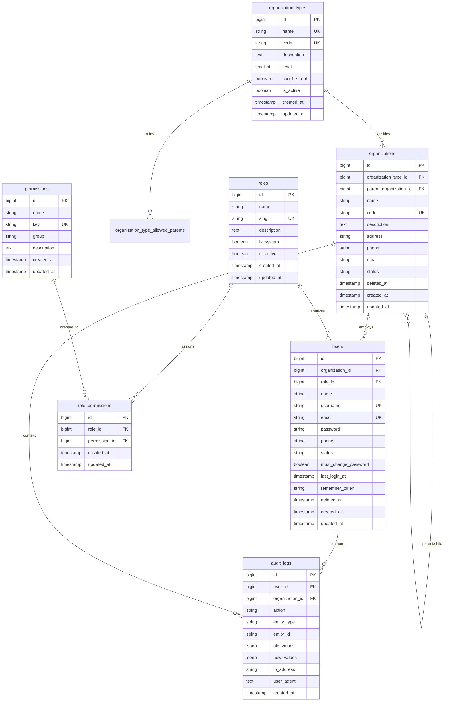

# Database Architecture & Foundation Specification (PostgreSQL)

## 1. Overview & ERD Relationships

The **Government Citizen Engagement Platform** uses a centralized, generic organizational structure on PostgreSQL designed to support current administrative tiers (Sub-Cities, Woredas, Bureaus) and any future government units without structural schema changes.

---

## 2. Table Specifications & Constraints

### 2.1 `organization_types` & `organization_type_allowed_parents`
- `organization_types`: Defines classifications (`sub_city`, `woreda`, `bureau`).
- `organization_type_allowed_parents`: Junction table enforcing allowed hierarchy trees.
  - Sub-City has `can_be_root = true` and no parent requirement.
  - Woreda allows only `sub_city` as parent.
  - Bureau allows `sub_city` or `woreda` as parent.

### 2.2 `organizations`
- Single generic entity supporting any organization tier.
- `parent_organization_id`: Nullable self-referencing foreign key with `restrictOnDelete` to prevent orphaned units.
- `organization_type_id`: Foreign key with `restrictOnDelete`.
- `code`: Globally unique identifier (e.g., `subcity-bole`, `woreda-01-bole`).
- `status`: Indexed status column (`active`, `inactive`, `suspended`).
- `deleted_at`: Soft delete timestamp for audit preservation.

### 2.3 `roles`, `permissions`, and `role_permissions`
- Fully independent of organization types.
- `permissions.key`: Unique identifier (e.g. `users.create`, `feedback.view_descendants`).
- `role_permissions`: Unique composite key `(role_id, permission_id)`.
- Core seeded roles: `super_admin`, `sub_city_admin`, `woreda_admin`, `bureau_admin`, `staff`.

### 2.4 `users`
- Each user belongs to **exactly one organization** (`organization_id`, foreign key with `restrictOnDelete`).
- Platform-wide Super Admin is permitted a nullable `organization_id`.
- Single role assignment via `role_id` (`restrictOnDelete`).
- Login identifiers: Unique `username` and unique `email`.
- Security flags: `must_change_password` (boolean), `status` (`active`, `inactive`, `suspended`), `last_login_at`.
- Soft delete support.

### 2.5 `audit_logs`
- Implements comprehensive audit trail.
- `user_id` and `organization_id` use `nullOnDelete` to guarantee audit trail preservation even if accounts are purged.
- `old_values` and `new_values` stored as native PostgreSQL `jsonb` payloads.
- Indexed by `[entity_type, entity_id]`, `created_at`, `action`, `organization_id`.

---

## 3. Database Integrity & Deletion Behavior

| Relationship | On Delete | Rationale |
| :--- | :--- | :--- |
| `organizations.parent_organization_id` &rarr; `organizations.id` | **RESTRICT** | Prevents deleting parent organizations that have active descendants. |
| `organizations.organization_type_id` &rarr; `organization_types.id` | **RESTRICT** | Protects type classifications from deletion while organizations exist. |
| `users.organization_id` &rarr; `organizations.id` | **RESTRICT** | Protects organizations with assigned users from accidental deletion. |
| `users.role_id` &rarr; `roles.id` | **RESTRICT** | Protects roles assigned to active users from accidental deletion. |
| `role_permissions.role_id` &rarr; `roles.id` | **CASCADE** | Cleaning up junction table when role is decommissioned. |
| `role_permissions.permission_id` &rarr; `permissions.id` | **CASCADE** | Cleaning up junction table if permission definition is removed. |
| `audit_logs.user_id` &rarr; `users.id` | **SET NULL** | Preserves historical audit records even if user record is purged. |
| `audit_logs.organization_id` &rarr; `organizations.id` | **SET NULL** | Preserves audit trail even if organization record is purged. |
