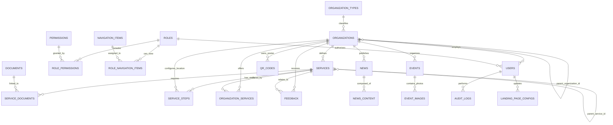

# Database Architecture & Foundation Specification (PostgreSQL)

## 1. Overview & ERD Relationships

The **Government Citizen Engagement Platform (CivicLink)** uses a centralized, generic organizational structure on PostgreSQL designed to support statutory administrative tiers (Sub-Cities, Woredas, Bureaus) and all civic workflows without schema redundancy.

---

## 2. Table Specifications (21 Tables)

### 1. `organization_types`
Administrative level taxonomy definition table.
- `id` (bigIncrements, PK)
- `name` (string, unique): e.g. "Sub-City", "Woreda", "Bureau"
- `code` (string, unique): e.g. "sub_city", "woreda", "bureau"
- `description` (text, nullable)
- `level` (unsignedSmallInteger, default 1): Hierarchy level (1=Sub-City, 2=Woreda, 3=Bureau)
- `can_be_root` (boolean, default false): Whether this tier can exist without a parent organization
- `is_active` (boolean, default true)
- `timestamps`

> **Note on Statutory Hierarchy Rules**: The legacy `organization_type_allowed_parents` junction table has been deprecated in favor of application business rules (`$parentType->level < $this->level`). This eliminates database query overhead while guaranteeing structural integrity.

### 2. `organizations`
Core administrative entity representing government offices and service delivery branches.
- `id` (bigIncrements, PK)
- `organization_type_id` (foreignId -> `organization_types.id`)
- `parent_organization_id` (foreignId -> `organizations.id`, nullable, restrictOnDelete)
- `name` (string): Official registered unit name
- `code` (string, unique): Human-readable slug (e.g. `subcity-bole`, `woreda-03`)
- `description` (text, nullable)
- `address`, `phone`, `email` (string, nullable)
- `status` (string, default 'active'): Enum `active`, `inactive`, `suspended`
- `deleted_at` (softDeletes)
- `timestamps`
- Index on `['organization_type_id', 'status']`
- Index on `['parent_organization_id', 'status']`

### 3. `roles`
System access roles governing functional authority and data scope boundaries.
- `id` (bigIncrements, PK)
- `name` (string): e.g. "Super Admin", "Sub-City Admin", "Woreda Admin", "Bureau Admin", "Staff"
- `slug` (string, unique)
- `scope_level` (string, default 'global'): Enum `global`, `sub_city`, `woreda`, `bureau`
- `description` (text, nullable)
- `is_system` (boolean, default false): Protected system roles
- `is_active` (boolean, default true)
- `timestamps`

### 4. `permissions`
Granular feature access permission definitions.
- `id` (bigIncrements, PK)
- `name` (string)
- `key` (string, unique): Canonical identifier (e.g. `organizations.view`, `services.manage`, `cms.manage`)
- `group` (string, indexed): Module grouping (e.g. `users`, `services`, `feedback`)
- `description` (text, nullable)
- `timestamps`

### 5. `role_permissions`
Many-to-many junction table mapping roles to permissions with granular CRUD capability flags.
- `id` (bigIncrements, PK)
- `role_id` (foreignId -> `roles.id`, cascadeOnDelete)
- `permission_id` (foreignId -> `permissions.id`, cascadeOnDelete)
- `can_create` (boolean, default true)
- `can_read` (boolean, default true)
- `can_update` (boolean, default true)
- `can_delete` (boolean, default true)
- `timestamps`
- Unique index on `['role_id', 'permission_id']`

### 6. `users`
Authenticated personnel accounts.
- `id` (bigIncrements, PK)
- `organization_id` (foreignId -> `organizations.id`, nullable, nullOnDelete)
- `role_id` (foreignId -> `roles.id`, restrictOnDelete)
- `name` (string)
- `username` (string, unique)
- `email` (string, unique)
- `password` (string, bcrypt hashed)
- `phone` (string, nullable)
- `status` (string, default 'active'): Enum `active`, `inactive`, `suspended`
- `must_change_password` (boolean, default false)
- `last_login_at` (timestamp, nullable)
- `deleted_at` (softDeletes)
- `timestamps`

### 7. `navigation_items`
Dynamic database-driven sidebar navigation items (**flat architecture without `parent_id`**).
- `id` (bigIncrements, PK)
- `label` (string): e.g. "Overview", "Sub-cities", "Accounts", "Feedback", "Services", "Routes", "QR Poster", "CMS"
- `route` (string): Frontend destination route (e.g. `/admin/overview`, `/admin/subcities`)
- `icon` (string, nullable): Lucide / Heroicon icon name
- `display_order` (unsignedInteger, default 1)
- `is_active` (boolean, default true)
- `required_permission` (string, nullable): Permission required to access route
- `timestamps`
- Index on `['is_active', 'display_order']`

### 8. `role_navigation_items`
Many-to-many junction table mapping authorized navigation menu items to roles.
- `id` (bigIncrements, PK)
- `role_id` (foreignId -> `roles.id`, cascadeOnDelete)
- `navigation_item_id` (foreignId -> `navigation_items.id`, cascadeOnDelete)
- `timestamps`
- Unique index on `['role_id', 'navigation_item_id']`

### 9. `services`
Master catalog of public civic services with self-referencing sub-service hierarchy.
- `id` (bigIncrements, PK)
- `organization_id` (foreignId -> `organizations.id`, nullable, nullOnDelete)
- `parent_id` (foreignId -> `services.id`, nullable, restrictOnDelete): Self-referencing link for sub-services
- `name` (string)
- `code` (string, unique)
- `description` (text, nullable)
- `eligibility_criteria` (text, nullable)
- `estimated_duration_minutes` (unsignedInteger, nullable)
- `fee_amount` (decimal 10,2, default 0.00)
- `fee_currency` (string 3, default 'ETB')
- `fee_notes` (text, nullable)
- `is_active` (boolean, default true)
- `deleted_at` (softDeletes)
- `timestamps`

### 10. `documents`
Required citizen document catalog.
- `id` (bigIncrements, PK)
- `name` (string)
- `code` (string, unique): e.g. `kebele-id`, `birth-notification`
- `description` (text, nullable)
- `is_active` (boolean, default true)
- `timestamps`

### 11. `service_documents`
Junction table linking required documents to services.
- `id` (bigIncrements, PK)
- `service_id` (foreignId -> `services.id`, cascadeOnDelete)
- `document_id` (foreignId -> `documents.id`, cascadeOnDelete)
- `is_mandatory` (boolean, default true)
- `order_column` (unsignedInteger, default 1)
- `notes` (text, nullable)
- `timestamps`
- Unique index on `['service_id', 'document_id']`

### 12. `organization_services`
Junction table declaring which government units provide which services.
- `id` (bigIncrements, PK)
- `organization_id` (foreignId -> `organizations.id`, cascadeOnDelete)
- `service_id` (foreignId -> `services.id`, cascadeOnDelete)
- `is_available` (boolean, default true)
- `timestamps`
- Unique index on `['organization_id', 'service_id']`

### 13. `service_steps`
Physical room-by-room routing instructions inside public bureaus.
- `id` (bigIncrements, PK)
- `service_id` (foreignId -> `services.id`, cascadeOnDelete)
- `organization_id` (foreignId -> `organizations.id`, nullable, cascadeOnDelete)
- `step_number` (unsignedInteger)
- `title` (string)
- `instruction` (text)
- `room_number` (string, nullable)
- `building_name` (string, nullable)
- `floor` (string, nullable)
- `estimated_minutes` (unsignedInteger, nullable)
- `timestamps`
- Index on `['service_id', 'step_number']`

### 14. `feedbacks`
Citizen grievance, suggestion, and inquiry submissions.
- `id` (bigIncrements, PK)
- `feedback_for_organization` (foreignId -> `organizations.id`, cascadeOnDelete)
- `service_id` (foreignId -> `services.id`, nullable, setNull)
- `feedback_content` (text)
- `feedback_type` (string): Enum `complaint`, `suggestion`, `feedback`, `satisfaction`
- `status` (string, default 'new'): Enum `new`, `in_review`, `resolved`, `closed`
- `tracking_number` (string 10, nullable, unique): 10-digit citizen tracking reference
- `full_name` (string, nullable)
- `phone_number` (string, nullable): Citizen telephone for SMS updates (**no email field**)
- `response` (text, nullable)
- `responded_at` (timestamp, nullable)
- `responded_by` (foreignId -> `users.id`, nullable)
- `timestamps`
- Index on `['feedback_for_organization', 'status']`

### 15. `qr_codes`
Office and reception desk physical poster tokens (**no `service_id`**).
- `id` (bigIncrements, PK)
- `organization_id` (foreignId -> `organizations.id`, cascadeOnDelete)
- `code` (string 64, unique): e.g. `QR-BOLE-REV-001`
- `label` (string 150): e.g. "Main Public Service Block Reception"
- `target_url` (string 2048)
- `scan_count` (unsignedBigInteger, default 0)
- `last_scanned_at` (timestamp, nullable)
- `status` (string 32, default 'active')
- `timestamps`
- Index on `['organization_id', 'status']`

### 16. `news`
Official announcements and notices.
- `id` (bigIncrements, PK)
- `organization_id` (foreignId -> `organizations.id`, cascadeOnDelete)
- `title` (string)
- `summary` (text, nullable)
- `status` (string, default 'draft'): Enum `draft`, `published`, `archived`
- `published_at` (timestamp, nullable)
- `timestamps`
- Index on `['organization_id', 'created_at']`

### 17. `news_content`
Normalized article content blocks.
- `id` (bigIncrements, PK)
- `news_id` (foreignId -> `news.id`, cascadeOnDelete)
- `content` (text)
- `content_type` (string): `text`, `image_url`, `callout`, `quote`
- `order` (unsignedInteger, default 1)
- `timestamps`
- Index on `['news_id', 'order']`

### 18. `events`
Community town halls and public civic events.
- `id` (bigIncrements, PK)
- `organization_id` (foreignId -> `organizations.id`, cascadeOnDelete)
- `title` (string)
- `description` (text)
- `location_name` (string)
- `event_date` (dateTime)
- `end_date` (dateTime, nullable)
- `audience` (string, nullable)
- `status` (string, default 'published'): Enum `draft`, `published`, `cancelled`
- `timestamps`
- Index on `['organization_id', 'event_date']`

### 19. `event_images`
Multiple photo gallery images per event.
- `id` (bigIncrements, PK)
- `event_id` (foreignId -> `events.id`, cascadeOnDelete)
- `image_url` (string 2048)
- `caption` (string 255, nullable)
- `order_column` (unsignedInteger, default 1)
- `timestamps`
- Index on `['event_id', 'order_column']`

### 20. `audit_logs`
Immutable administrative audit trails with full JSON request/response diagnostics.
- `id` (bigIncrements, PK)
- `user_id` (foreignId -> `users.id`, nullable, nullOnDelete)
- `action` (string 64): Action verb (`created`, `updated`, `deleted`, `password_reset`, `cms_updated`)
- `entity_type` (string 128): Entity class name
- `entity_id` (string 64, nullable)
- `status` (string 32, default 'success'): Enum `success`, `failed`
- `status_code` (unsignedSmallInteger, nullable): HTTP response code (200, 201, 403, 422, 500)
- `error_message` (text, nullable)
- `request_payload` (jsonb, nullable): Complete sanitized incoming request parameters
- `response_payload` (jsonb, nullable): Returned JSON payload or exception trace on failure
- `old_values` (jsonb, nullable)
- `new_values` (jsonb, nullable)
- `ip_address` (string 45, nullable)
- `user_agent` (text, nullable)
- `created_at` (timestamp, indexed)
- Index on `['entity_type', 'entity_id']`

### 21. `landing_page_configs`
Super Admin Landing Page Content Management System (CMS).
- `id` (bigIncrements, PK)
- `version` (string, default 'v1', unique)
- `is_published` (boolean, default true)
- `content` (jsonb): Complete 8-section configuration tree:
  1. `announcement`
  2. `hero` (with carousel slides)
  3. `quickSearch`
  4. `serviceGuide`
  5. `journey`
  6. `newsEvents`
  7. `feedback`
  8. `footer`
- `updated_by` (foreignId -> `users.id`, nullable, nullOnDelete)
- `timestamps`
